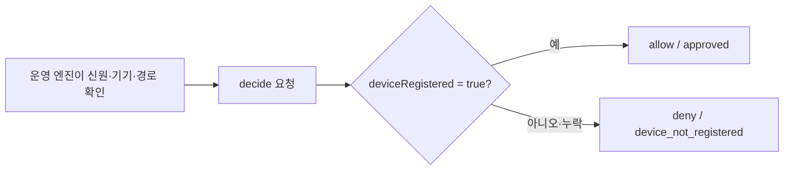
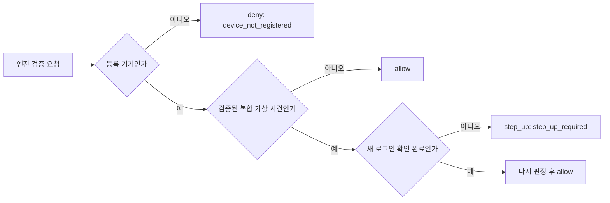
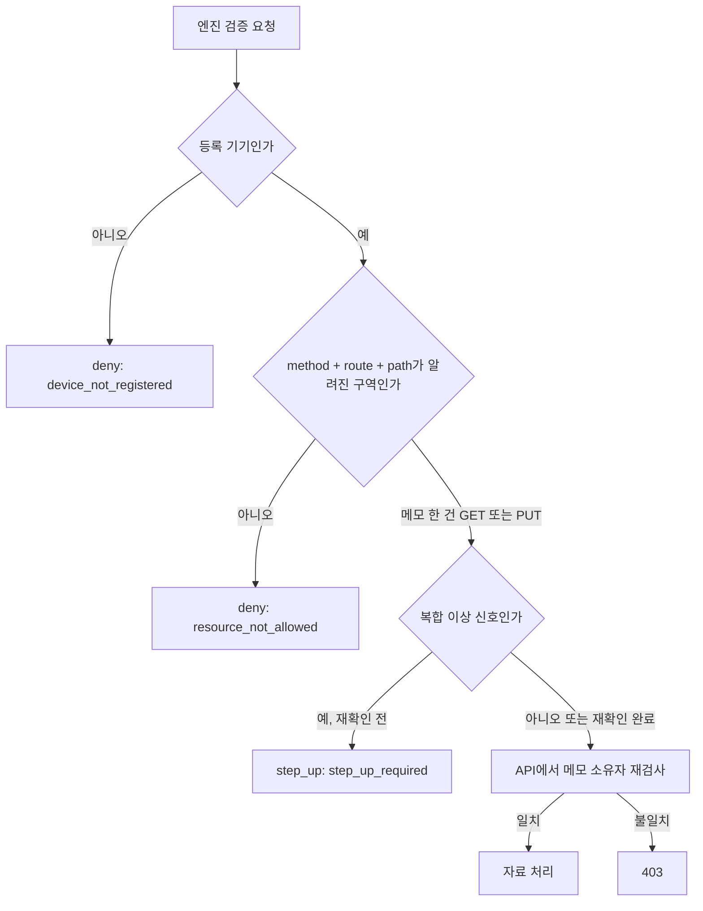
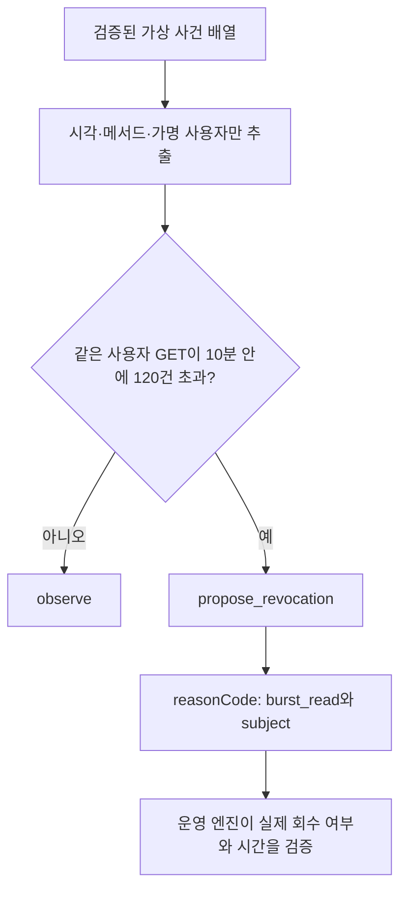
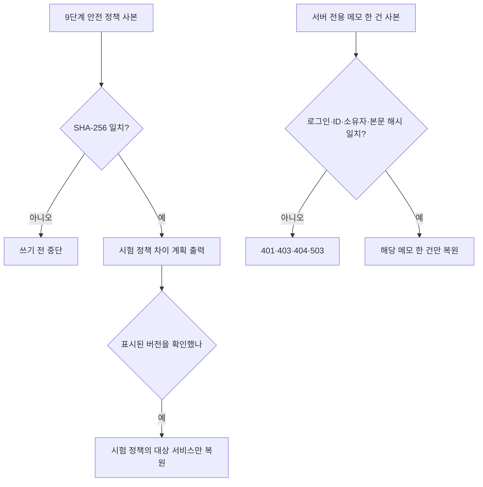
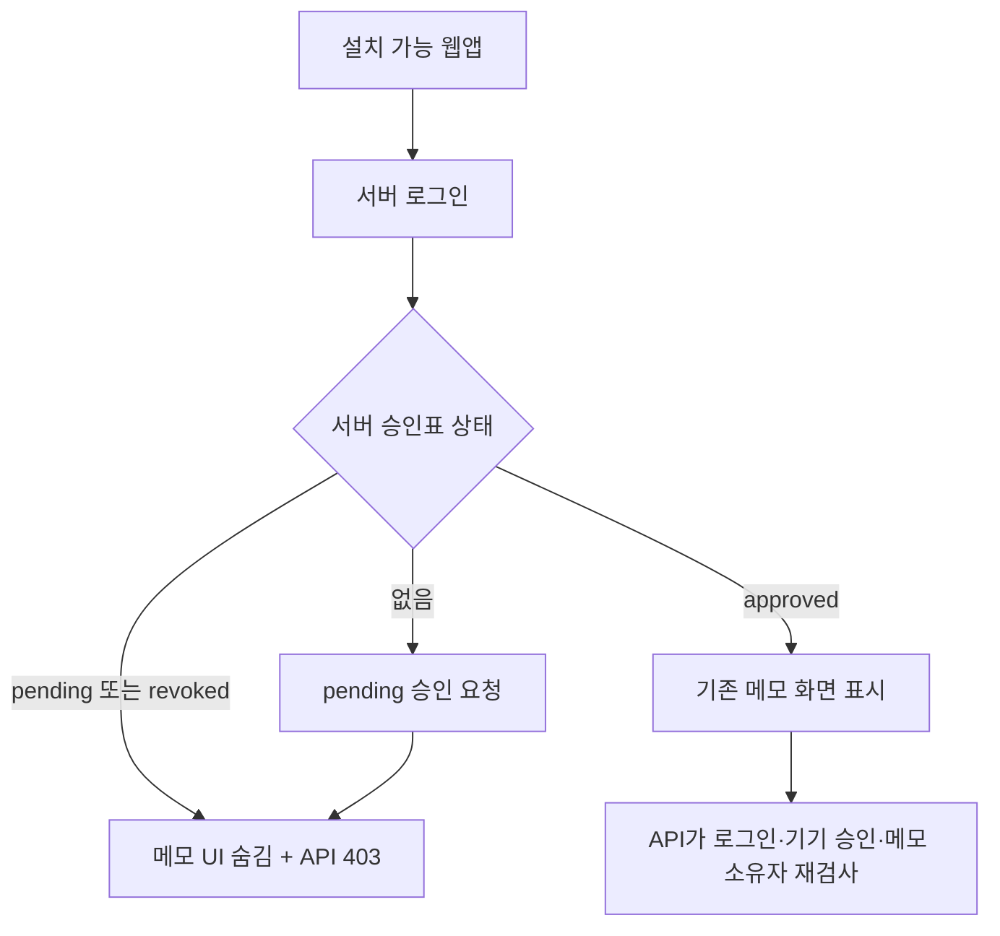
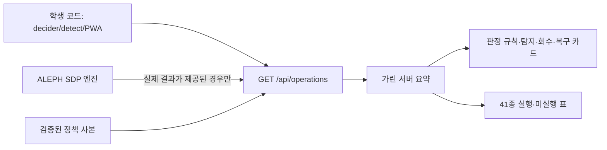

# BYTE BACK 방어전 시작 틀 R5

이 저장소는 1단계에서 학생 본인이 GitHub 저장소와 Vercel 배포를 만드는 출발점입니다. 포함된 메모 네 건은 가상 자료입니다. 실제 학생 자료, 토큰, 비밀키를 넣지 마세요.

## 학생이 하는 일: 세 걸음

1. GitHub 계정을 만듭니다.
2. 방어전 1단계 카드의 **Deploy** 버튼을 누릅니다. Vercel에 GitHub로 로그인하고, 새 저장소가 **본인 계정의 Public 저장소**인지 확인한 뒤 Deploy를 누릅니다.
3. 배포가 끝나면 화면에 나온 `https://…vercel.app` 주소를 방어전 1단계 카드에 붙여넣고 제출합니다. 저장소 주소나 설정 파일은 적지 않습니다.

배포가 끝나면 `/`에서 점령된 가상 자료실을 볼 수 있습니다. `/data.json`에는 같은 가상 메모가 공개됩니다. 이 공개 상태를 확인하는 것이 1단계의 출발점입니다. 1단계 접수와 심판 판정은 포털에서 확인합니다.

## 시작 틀의 자동 처리

`vercel.json`은 정적 결과물 `public`을 배포합니다. 빌드 명령 `npm run build`는 Vercel이 제공하는 GitHub 저장소 소유자·이름, 커밋 SHA, 배포 URL을 검증하고 `public/aleph.json`을 생성합니다. 이 값이 없으면 빌드가 실패하므로, 성공한 것처럼 빈 주소를 내보내지 않습니다. `aleph.json`의 내용만으로 저장소 소유권이나 방어 성공을 인정하지 않습니다. 심판이 공개 저장소의 실제 커밋과 배포된 자료를 따로 대조해야 합니다.

`aleph.config.json`의 `repoUrl`과 `publicAppUrl`은 이전 제출 묶음 방식의 자리표시자입니다. 1단계에서는 학생이 편집하지 않습니다. 2단계 이후 코딩 도구가 필요한 설정과 보호 기능을 단계별로 작성합니다. `npm run bundle`과 `bundle-notes.json`도 1단계의 세 걸음에는 포함되지 않습니다.

로컬에서 가상 화면만 확인할 때는 `npm run build -- --local`을 사용합니다. 로컬 실행은 Vercel 배포나 심판 접수를 증명하지 않습니다. 저장소의 `src/attack-check.mjs`는 실제 배포가 된 뒤 `/data.json`을 비로그인으로 요청해 공개 가상 메모의 확인 표시를 읽습니다.

## 다음 단계의 코딩 도구에 전달할 규칙

[AGENTS.md](AGENTS.md)를 먼저 읽히고 한 번에 한 제작 단위만 요청하세요. 2단계부터는 자료 보호를 구현할 때 `public/data.json`을 복사하는 1단계 빌드 흐름도 함께 바꿔야 합니다. 3단계 이후의 로그인, 허용 경로, 5단계의 원본 API 주소, 6단계 이후 정책 규칙은 해당 단계 원고와 계약에 맞춰 추가합니다. 비밀번호·토큰·서버 전용 키·실제 학생 기록을 코드, Git, 제출 묶음에 넣지 않습니다.

`src/decider.mjs`와 `src/detect.mjs`의 로컬 시험은 반 엔진이나 운영 심판의 결과가 아닙니다. 1단계 이후 제출 묶음 계약 `aleph.defense.submission.v2`는 `scripts/bundle.mjs`에 남아 있으며, 코딩 도구가 해당 단계의 최신 배포 주소와 Git 원격을 맞춘 뒤 사용합니다.

## 2단계 저장점

마지막 1단계 커밋: 5e96d15 Initial commit. 작업 시작 시 다른 변경사항 없음.
원본 data.json 확인 결과 가상 메모 4건이며, 요청의 '세 개'와 달리 실제 4건을 기준으로 이전했습니다.
화면은 /api/notes에서 네 카드를 읽습니다. 루트와 public/data.json에는 빈 notes 배열만 있습니다.
SQL은 공개 Git/정적 파일에 넣지 않는 별도 로컬 산출물 step2-supabase.sql입니다.
Supabase SQL Editor에서 실행한 뒤 owner_id의 uuid 자료형, RLS true, 정책 없음,
anon/authenticated SELECT false를 확인하세요. 새 학습용 테이블이 이미 있으면 SQL은 덮어쓰지 않고 실패합니다.
Vercel 프로젝트 Settings → Environment Variables에서 SUPABASE_URL과 서버 전용 SUPABASE_SECRET_KEY를 직접 설정하고 재배포하세요.
키 값을 채팅이나 파일에 붙여 넣지 마세요. 서버는 upstream 응답/오류/키를 로그에 쓰지 않습니다.
로컬 정적 확인: npm run build -- --local. API 확인은 환경변수가 설정된 Vercel 배포에서 합니다.

### 남은 약점

/api/notes는 로그인 인증이 없는 공개 URL입니다. 누구나 API로 네 메모를 읽을 수 있습니다.
RLS와 브라우저 키 제거는 공개 API의 접근 통제를 대신하지 않습니다.
과거 공개 커밋과 과거 배포에 메모가 남을 수 있으므로 과거 노출이 해소됐다고 판단하지 않습니다.

### 검증과 기록

GitHub 최신 커밋을 별도 폴더에 받아 원본 가상 메모 본문 네 문장을 검색하세요.
검색할 문장은 로컬 SQL에서 확인하고, 문장을 README/검색 결과/제출 묶음에 복사하지 마세요.
검색 대상은 전체 추적 파일이며 검색 결과에는 파일 경로와 일치 개수만 기록하세요.
최신 배포의 /, /data.json, 페이지가 참조하는 JS 및 기타 정적 파일에도 같은 검색을 수행하세요.
/data.json은 notes: []이어야 하고, 화면은 네 카드가 표시되어야 합니다.
비로그인 /api/notes GET은 네 메모를 반환하는 남은 약점이고, POST는 405여야 합니다.
Supabase에서 anon/authenticated로 직접 SELECT는 거부되어야 합니다.

| 점검 | 결과 | 커밋/배포 주소·시각 |
| --- | --- | --- |
| 최신 Git 전체 추적 파일 본문 검색 | 로컬 전체 추적 파일 0건, GitHub는 미실행 | 배포 후 기록 |
| 최신 배포 정적 파일 본문 검색 | 미실행 | 배포 후 기록 |
| /data.json 빈 배열 | 로컬 빈 배열 확인, 배포 미실행 | 배포 후 기록 |
| 화면 네 카드·API GET | DB 설정/배포 후 확인 필요 | 배포 후 기록 |
| 공개 API 남은 약점 | 인증 없는 URL 구현 | 배포 후 기록 |
| Supabase owner_id/RLS/권한 | SQL Editor 미실행 | 실행 후 기록 |

실행하지 않은 배포·검증은 성공으로 기록하지 않습니다. 자기 점검은 심판 판정이 아닙니다.
설정의 실제 배포 주소는 확인 후에만 맞추고 judgeIssuer는 보존합니다.

## 3단계 구현 및 저장점

시작 커밋은 `744d6f3 보안 헤더 추가`였고 Git 상태는 깨끗했습니다.
2단계 기록 이후 보안 헤더가 추가됐지만 이전 결과 표에는 반영되지 않아 이 절에서 보완합니다.
2단계 실제 배포 점검에서 정적 메모 0건, API 가상 메모 4건, nosniff와 GitHub 최신 본문 검색 0건을 확인했습니다.
DB 내부 점검은 사용자가 완료했다고 확인했으며 코딩 도구가 DB에 직접 접속해 검증한 결과는 아닙니다.

현재 구현은 Supabase 공식 SDK 이메일·비밀번호 로그인/로그아웃, 내 메모 목록과 추가·수정·삭제입니다.
공개 Project URL/publishable key 연결 완료. 실제 A 로그인 검증은 사용자가 화면에서 확인해야 합니다.
서버는 변경하지 않은 src/verify-login.mjs의 createLoginVerifier로 Authorization 토큰을 확인합니다.
브라우저 userId/role/owner_id를 믿지 않으며 POST의 owner_id는 검증된 사용자 ID입니다.
목록은 본인 owner_id만 조회합니다. 개별 GET/PUT/DELETE에는 아직 소유자 검사가 없으므로 B가 A의 메모 ID를 알면 읽기·수정·삭제할 수 있습니다. 4단계에서 막습니다.
과거 공개 커밋과 배포의 노출은 로그인 추가로 해소되지 않습니다.

### DB 및 계정 설정

Supabase SQL Editor에서 sql/step3-auth.sql을 실행합니다. 기존 정수 ID를 UUID로 바꾸며 메모와 owner_id를 보존합니다.
서버 역할에 CRUD 권한을 주지만 anon/authenticated에는 직접 자료 권한이나 읽기 정책을 주지 않습니다.
이미 UUID인 테이블에서는 ID를 다시 바꾸지 않습니다. auth.users 외래키를 추가하지 않습니다.
이전 네 메모의 owner_id가 NULL이면 내 목록에는 나오지 않습니다. 삭제하지 않고 DB에 보존합니다.
Authentication → Users에서 학습용 A/B 계정을 준비하고 Email 로그인 공급자를 사용합니다. 비밀번호는 공식 화면에서 직접 설정합니다.
Vercel의 기존 SUPABASE_URL과 SUPABASE_SECRET_KEY는 같은 프로젝트를 가리켜야 합니다.
public/login-config.json에는 공개용 설정만 넣고 서버 키는 절대 넣지 않습니다.

### 실행과 점검

명령: npm run build -- --local
정상: 로그인 폼 → A 로그인 → 내 메모 목록 → 가상 메모 추가 → 수정 → 삭제 → 로그아웃 상태.
거부: 무로그인 모든 자료 경로와 잘못된 토큰은 JSON 오류 401/403이며 자료를 반환하지 않습니다.
POST /api/notes는 {id?,title,body}를 받고 201 {id}를 반환합니다. id는 UUID이며 생략하면 서버가 만듭니다.
GET /api/notes는 본인 메모 배열, GET/PUT/DELETE /api/notes/:id는 개별 메모 경로입니다.
GET 한 건과 PUT 결과는 {id,title,body}, DELETE는 204, 삭제 후 GET은 404입니다.
로그아웃은 SDK의 현재 세션 로그아웃입니다. 이미 발급된 액세스 토큰은 만료 전까지 유효할 수 있습니다.
/aleph.json 자동 생성과 nosniff 설정을 유지합니다. 저장점 이후 npm run bundle로 실제 배포 응답을 다시 기록합니다.

| 점검 | 현재 결과 |
| --- | --- |
| 로컬 인증 거부/CRUD/입력 위조/오류 응답 | 모의 시험 7개 통과 |
| 검증 도우미 | 수정하지 않음 |
| DB UUID 이전 | 실제 DB 메모 4건 UUID 확인, 공개 키 직접 조회 거부 확인 |
| 실제 A 로그인/로그아웃/CRUD | 3단계 사용자 확인 완료 (코딩 도구 실계정 시험 아님) |
| 실제 B 타인 메모 접근 | 미실행, 소유자 검사 없음 |
| 3단계 새 배포·무로그인 거부 | 실제 배포 JSON 401, nosniff, aleph.json 확인 완료 |

자기 점검은 심판 판정이 아닙니다. 메모 본문/비밀번호/JWT/서버 키는 제출 묶음에 넣지 않습니다.

## 4단계 저장점: 본인 메모만 접근

시작 커밋: 23a34ec 3단계 저장점. 시작 시 Git 상태는 깨끗했습니다.
README의 3단계 사용자 확인/배포 기록 누락을 보완했습니다. 이전 단계 절은 당시 기능과 결과의 이력입니다.
현재 서버는 검증한 사용자 ID와 기존 행의 owner_id를 비교하며 본인 목록·추가·개별 조회·수정·삭제만 허용합니다.
타인 또는 owner_id NULL 행은 개별 접근 403, 없는 ID는 404, 인증 없음/실패는 JSON 401입니다.
소유자를 지정하는 URL 쿼리나 본문 입력은 403으로 거부합니다. userId·role도 인증 근거로 쓰지 않습니다.
POST 소유자는 검증한 ID로만 저장합니다. PUT은 기존 소유자 확인 후 owner_id 필터와 검증된 새 소유자를 함께 사용합니다.
DELETE도 기존 소유자 확인과 쓰기 시 소유자 필터를 함께 사용해 검사와 변경 사이의 소유자 변경을 방어합니다.
응답에는 owner_id를 내보내지 않고 {id,title,body}만 유지합니다.
실제 허용 경로는 GET/POST /api/notes와 GET/PUT/DELETE /api/notes/:id이며 설정에 기록했습니다.

### 사용자가 검토할 SQL (자동 실행하지 않음)

1. artifacts/step4-owners.sql: A_EMAIL_HERE/B_EMAIL_HERE를 SQL Editor에서 실제 A/B 이메일로 입력합니다.
   auth.users에서 각 ID를 조회합니다. 기존 원본 세 제목이 정확히 한 건씩 있을 때만 A에 연결하고 B 시험 한 건을 준비합니다.
   원본 네 건 중 선택하지 않은 네 번째와 다른 계정의 메모는 보존합니다. 다른 소유자가 이미 있거나 제목이 중복되면 전체 중단합니다.
   이메일과 시험 본문이 담기는 이 파일은 Git 제외이며 제출 묶음에 넣지 않습니다.
2. sql/step4-rls.sql: learning_notes만 변경합니다. 기존 테이블/열 권한과 정책을 조회·회수하고 authenticated에 CRUD만 부여합니다.
   이 테이블의 기존 정책을 교체합니다. SELECT/DELETE USING, INSERT WITH CHECK, UPDATE USING/WITH CHECK 모두 auth.uid()=owner_id입니다.
   전후 role_table_grants와 has_table_privilege 결과를 대조합니다. anon은 모두 false, authenticated는 CRUD true·그 밖 false여야 합니다.
   예상 밖 역할 상속 권한이 남으면 롤백하며 다른 역할/테이블을 변경하지 않습니다. 서버 역할의 기존 권한은 보존합니다.

서버 Secret Key는 RLS를 우회하므로 앱의 소유자 검사가 별도로 필요합니다.
직접 Data API 자기 점검은 공개 publishable key만 보내 anon 역할의 읽기 거부를 확인합니다.
인증 사용자 JWT를 사용하는 직접 Data API 접근은 심판이 재현할 수 없으므로 점수 근거로 기록하지 않습니다.
DB RLS는 검토용 설계이며, SQL Editor에서 사용자가 실행하기 전에는 적용 완료로 표현하지 않습니다.
과거 공개 커밋/배포 노출은 이번 접근 제한으로 해소됐다고 표현하지 않습니다.

### 재실행과 확인

명령: npm run bundle
화면: Supabase SQL Editor에서 소유자 연결 → 권한 SQL 실행 후 자료실에서 A/B 계정을 번갈아 로그인합니다.
정상: 각 계정의 본인 메모 조회·추가·수정·삭제 성공, 삭제 후 GET 404.
거부: 무로그인 JSON 401, 상대 메모 GET/PUT/DELETE 403, owner_id 변경 403.
/aleph.json 자동 생성과 nosniff를 보존했습니다. 인증 검증 도우미와 정책 판정기는 수정하지 않았습니다.

| 점검 | 결과 |
| --- | --- |
| 본인 CRUD·상호 접근 거부·소유자 변경·경합 방어 | 로컬 모의 시험 9개 통과 |
| 로컬 정적 빌드 | 통과, 메모 없는 data.json 유지 |
| 4단계 A/B 실계정 교차 접근 | 사용자 확인: 양방향 GET/PUT/DELETE 403, 본문/URL owner_id 변경 403, 본인 CRUD 정상 및 삭제 후 GET 404 |
| 소유자 연결·RLS 실제 권한 전후 | 사용자 화면 확인: RLS true, 본인 행 정책 4개, anon 전부 false, authenticated CRUD만 true |
| 최신 배포의 무로그인·보안 헤더·aleph.json·anon 직접 읽기 | npm run bundle 실제 요청으로 기록 |

위 기록은 자기 점검이며 심판 판정이 아닙니다.

## 5단계 저장점: 자료 요청은 서버로만

시작 커밋: 0659653 4단계 사용자 검증 기록 갱신. Git 상태는 깨끗했습니다.
그 뒤 사용자 화면 증거로 확인한 4단계 양방향 접근 차단·소유자 변경 거부·RLS 결과를 위 표에 반영했습니다.
브라우저의 직접 메모 자료 호출: 없음. 기존 목록/조회/추가/수정/삭제는 모두 /api/notes 서버 함수를 사용합니다.
이 점검으로 자료 호출 코드는 변경하지 않았습니다. 기존 서버 로그인 검증·소유자 검사도 변경하지 않았습니다.
5단계 설정에 쿼리 없는 HTTPS 원본 테이블 경로를 기록했고 aleph.json에 allowedRoutes를 생성하도록 준비했습니다.

sql/step5-server-only.sql은 learning_notes의 PUBLIC/anon/authenticated 직접 권한을 회수하는 검토용 SQL입니다.
적용 전후 role_table_grants 및 has_table_privilege를 대조하며 anon/authenticated 모두 false가 정상입니다.
기존 service_role CRUD, RLS 정책·메모·소유자·Auth·다른 테이블은 보존합니다.
PostgreSQL SQL/PLpgSQL 문법 검사와 기존 API 모의 시험 9개는 통과했습니다. DB SQL은 실행하지 않았습니다.

공개 키는 서버 전용 config/auth.json으로 옮겼습니다. public/login-config.json과 브라우저 Supabase SDK는 제거했습니다.
사용자 요청에 따라 Auth 로그인·로그아웃도 /api/auth 서버 함수에서 Supabase 공식 SDK로 처리합니다.
서버는 기존 검증 도우미로 토큰을 검사한 뒤 HttpOnly·Secure·SameSite=Strict 쿠키에 세션을 보관합니다.
브라우저 JS/JSON 응답에는 실제 공개 키나 인증 토큰을 반환하지 않습니다. 원시 토큰은 HttpOnly 쿠키로만 전달합니다.
쿠키 인증을 기존 메모 API Authorization 검증에 연결했으며 외부 Bearer 요청의 검증 흐름은 유지했습니다.
쿠키를 사용하는 변경 요청은 동일 출처 검사 후 처리합니다. 서버의 공개 키·Secret Key는 응답/로그에 출력하지 않습니다.
사용자가 입력한 이메일/비밀번호는 HTTPS 로그인 요청으로만 전달하고 파일·로그·제출 묶음에 저장하지 않습니다.
공식 SDK refreshSession으로 만료된 세션을 갱신하며 signOut은 현재 세션 로그아웃입니다.
이전 브라우저 SDK 로그인 상태는 자동 이전하지 않으므로 새 화면에서 다시 로그인해야 합니다.

### SQL 적용 및 검증

명령: npm run bundle
Supabase SQL Editor에서 sql/step5-server-only.sql을 검토하고 실행하세요. 다른 테이블이나 Auth는 바꾸지 않습니다.
적용 후 anon/authenticated의 SELECT·INSERT·UPDATE·DELETE 및 기타 표에 표시된 권한은 모두 false,
service_role의 CRUD는 true여야 합니다. 기존 RLS는 유지하되 직접 호출은 GRANT 회수로 차단합니다.
화면의 메모 요청은 Vercel API만 사용합니다. 정상 A CRUD는 기존 서버 소유자 검사와 서버 역할 권한으로 유지됩니다.
직접 원본 요청 자기 점검은 서버에서 공개 키만 전송하고 사용자 JWT나 Secret Key를 보내지 않습니다.
/aleph.json에는 allowedRoutes와 쿼리 없는 originalApiUrl을 포함합니다. nosniff와 정적 메모 0건도 유지합니다.

| 점검 | 결과 |
| --- | --- |
| 기존 메모 직접 브라우저 호출 | 없음, 자료 호출 경로 변경 없음 |
| 서버 Auth/쿠키/CSRF 및 본인 CRUD·타인 거부 | 로컬 모의 시험 14개 통과 |
| 정적 파일 공개 키·브라우저 Supabase 호출 검색 | 없음 |
| 직접 권한 회수 SQL | 사용자 SQL 실행 결과 확인: anon/authenticated 모든 직접 권한 false, service_role CRUD true |
| A 정상 로그인/로그아웃·CRUD | 5단계 사용자 확인 완료: 본인 CRUD 정상, 로그아웃 후 메모 숨김 |
| A/B 상대 메모 접근 | 5단계 사용자 화면 확인 완료: 양방향 GET·PUT·DELETE 모두 403 |
| 무로그인 목록 요청 | 사용자 화면에서 401 및 JSON 오류 확인, bundle 실제 요청으로 재확인 |
| 최신 배포 헤더·허용 경로·공개 키 제거·무로그인 거부 | npm run bundle 실제 요청으로 기록 |

기존 공개 커밋과 과거 배포의 키/자료는 이번 변경으로 삭제되지 않습니다. 자기 점검은 심판 판정이 아닙니다.

5단계 검증 기록 갱신: 실계정·DB 확인은 사용자의 실행 결과와 화면 증거이며 도구가 대신 로그인하거나 SQL을 실행한 결과가 아닙니다.
제출 묶음 재생성은 npm run bundle로 실행합니다. Node.js 20의 경로 계산 오류는 5884202에서 수정했습니다.

## 보너스 xdr-01 저장점

시작 커밋은 5071314이며 Git 상태는 깨끗했습니다. 이전 주석 작업을 포함한 기존 파일은 보존했습니다.
기존 판정기는 src/decider.mjs 내부의 starter.deny 한 규칙으로 모든 요청을 거부하며 외부 규칙을 읽지 않습니다.
이번 작업은 xdr/brute-force의 가상 경보 읽기·패턴 분류·만료 거부 후보·추가 판정 어댑터와 알림 기록입니다.
MITRE T1110/T1110.003 공식 설명을 근거로 두 패턴을 작성했으며 수치 임계값은 학습용 기준입니다.
원본 경보·기존 판정기·로그인/메모 API·단계 5 설정 및 judgeIssuer는 변경하지 않았습니다.

실행: npm run xdr:run -- brute-force
결과 파일: xdr/brute-force/result.json. 알림 파일: xdr/alerts.log.
검증: 경보 28건과 추출 28줄 일치, block 10 · alert 9 · record 9, 정상 이벤트 9건의 block 0건.
로컬 시험은 추출·비밀값 제거·확신도 경계·미응답·분류·만료·정상 흐름 보존을 확인했습니다.
첫 시험 실패는 동일 출발 주소·계정의 두 번째 경보가 아직 만료되지 않은 시험 시각 때문이며 시험 시각만 수정했습니다.
decide.mjs는 import·파일 접근·네트워크 없이 한 파일에서 즉시 판정하며 애매한 경보는 alert로 기록합니다.
respond.mjs는 block 후보만 만료 규칙으로 만들고 alert를 한 줄씩 누적하며, 검증된 주소 매핑을 받는 추가 거부 어댑터를 제공합니다.
기존 모든 요청 거부를 보존했으므로 운영 정상 요청 통과나 실제 공격 차단 성공으로 보고하지 않습니다.
허용 모의 판정기를 연결한 어댑터 시험에서는 명확한 공격만 추가 거부하고 정상 요청은 통과했습니다. 실제 운영 연결 완료를 뜻하지 않습니다.
차단 후보는 경보를 처리한 시각부터 15분 동안 유효하며, 같은 출발 주소가 계정을 바꿔도 추가 거부합니다.
상세 구조와 남은 연결 사항은 [보너스 설명](xdr/brute-force/README.md)을 확인하세요.

## 보너스 xdr-02 저장점

웹 주입 모듈은 xdr/fixtures/web-injection.json의 가상 Wazuh 경보를 읽어 SQL 구문, 스크립트 삽입,
상위 경로 반복을 MITRE ATT&CK T1190 기반 패턴으로 판정합니다. 원본 경보와 src/decider.mjs는 변경하지 않았습니다.
read-alerts.mjs는 확인용 다섯 필드만 출력하며 decide.mjs와 분리되어 있습니다.
decide.mjs는 import·파일 접근·네트워크 없이 한 파일에서 즉시 block·alert·record를 반환합니다.
respond.mjs는 재검증된 block 후보만 15분 거부 규칙으로 만들고 alert만 xdr/alerts.log에 누적합니다.
실행: `npm run xdr:run -- web-injection`. 검사: `node --test test/web-injection.test.mjs test/xdr-run.test.mjs`.
가상 경보 26건과 추출 26줄이 일치하며 block 8 · alert 9 · record 9, 정상 이벤트 block 0건입니다.
허용 모의 기본 판정기를 사용한 추가 어댑터 시험에서 공격 주소는 거부되고 정상 주소는 통과했습니다.
이는 로컬 가상 시험이며 실제 운영 연결이나 심판 판정 결과를 뜻하지 않습니다.

## 코드 설명 읽기

함수 위의 한국어 주석에서 역할을 확인할 수 있습니다. JSON은 주석을 허용하지 않으므로 [JSON 항목 묶음 설명](docs/JSON_COMMENTS.md)을 함께 읽으세요.

## 6단계 저장점: 등록한 기기만 자료실 접근

시작 커밋은 `5ea26fd 2026.10.08.`이며 시작 시 Git 상태는 깨끗했습니다.
README의 마지막 기능 기록은 `82bcb7b 보너스 xdr-02 저장점`이었고, 이후 `5ea26fd`는 XDR 로그와 만료 규칙만 갱신했습니다.
기존 자료실 주소, 로그인·본인 메모 CRUD, 브라우저 화면, XDR 모듈과 `aleph.config.json`은 변경하지 않았습니다.

판정 요청은 운영 엔진이 확인한 최상위 `subjectId`와 `deviceRegistered`를 사용합니다.
`subjectId`는 발급자·대상·반·프로젝트를 묶은 가명 주체 ID이며 Supabase 사용자 번호와 직접 비교하지 않습니다.
`deviceRegistered`가 정확히 `true`이면 `device_registered` 규칙으로 allow·approved를 반환합니다.
false·누락·다른 값은 모두 deny·device_not_registered로 기본 거부합니다.
인증서·CA·서명 키·기기 개인키를 만들거나 코드·Git·로그·제출 묶음에 넣지 않습니다.

확인 명령: `npm run decider:test`

1. 실행기는 계약에 맞는 등록 기기의 정상 자료 읽기 요청을 만들고 allow인지 확인합니다.
2. 같은 가상 요청에서 `deviceRegistered`만 false로 바꿔 deny·device_not_registered인지 확인합니다.
3. 이 명령은 로컬 가상 연습이며 미등록 공격에 대한 실제 심판 판정이나 운영 연결 결과로 기록하지 않습니다.
4. 별도 접속 프로그램 설치나 키 생성 명령은 없습니다.

정상 결과는 `통과 · 등록 기기의 정상 요청`, 거부 결과는 `통과 · 미등록 기기의 가상 요청`입니다.

## 7단계 저장점: 복합 이상 접속은 다시 확인

시작 커밋은 `63251e3 6단계 Vercel 빌드 수정`이며 시작 시 Git 상태는 깨끗했습니다.
6단계 README 뒤의 단계 50 지원과 Node.js 20/Vercel 빌드 호환 보완을 이 절에 반영합니다.
기존 `device_registered` 규칙, 자료실 화면, 로그인·메모 API, XDR 모듈과 배포 주소는 보존합니다.

판정기는 계약에 있는 `signals`, `recentEvents`, `stepUp`만 사용하고 브라우저 헤더를 읽지 않습니다.
`signals.source`가 `judge_fixture`인 심판 가상 사건만 복합 신호 연습에 사용합니다.
출처가 `none`·누락·임의 문자열이면 지역·시각·네트워크를 정상값으로 채우거나 신뢰 신호로 승격하지 않습니다.
지역 하나만 다르거나 단일 신호만 있는 요청은 영구 차단하지 않습니다.

`step_up_required`는 등록 기기이면서 이상 시각, 처음 보는 네트워크, 최근 5분 내 대량 읽기 신호가 함께 있을 때만 적용합니다.
재로그인 전에는 `step_up`·`step_up_required`를 반환해 엔진에 추가 확인을 요청합니다.
같은 복합 사건에서 제공 엔진이 `stepUp.verified=true`와 0~900초의 새 로그인 시각을 확인해 전달하면 다시 판정해 allow합니다.
토큰 원문·비밀번호·위치 원문은 판정 입력이나 응답에 추가하거나 기록하지 않습니다.

확인 명령은 `npm run fixture:7`과 `npm run decider:test`입니다.
정상 가상 사건은 allow, 복합 이상 사건은 step_up, 다시 확인한 복합 사건은 allow가 정상입니다.
미등록 기기는 복합 신호보다 먼저 deny되며, 위조한 클라이언트 출처와 지역 하나만 다른 요청은 step_up 근거가 되지 않습니다.
로컬 연습에서는 결정 차이만 확인합니다. 실제 자료가 추가 확인 전에 차단되고 새 로그인 뒤 전달되는지는 제공 엔진과 심판이 검증하므로 현재 미실행입니다.

## 8단계 저장점: 자료 구역별 접근 제한

시작 커밋은 `065d54b 7단계 저장점`이며 README 단계 기록과 일치했고 Git 상태는 깨끗했습니다.
기존 자료실 주소와 메모 CRUD 화면, `device_registered`, `step_up_required` 규칙은 유지합니다.
메모와 강사 공지는 각각 `note:<uuid>`, `announcement:<uuid>` 자원 ID로 구별하며 화면 메뉴는 추가하지 않습니다.
첫 제출의 두 단계 자원 경로는 심판 계약보다 깊어 정상 요청을 막았으므로, 피드백 `S08_OWN_BROKEN`·`S08_OTHER_ZONE_ALLOWED`에 따라 기존 `/notes/:id`·`/announcements/:id` 깊이로 교정했습니다.
재검증의 피드백에 따라 메모 전체 목록과 공지 구역은 거부하고, 메모 한 건의 소유자는 최종 자료 API가 저장된 소유자와 대조하도록 교정했습니다.

판정기는 계약에 있는 `subjectId`, `deviceRegistered`, `method`, `route`, `path`, `queryLength`만 사용합니다.
메모 한 건의 `GET·PUT /notes/:id`만 허용하고 `/api` 접두사가 붙은 같은 경로도 동일하게 처리합니다.
메모 전체 목록 `GET /notes`와 공지 구역의 읽기·쓰기는 판정기에서 모두 `deny · resource_not_allowed`입니다.
판정 요청에는 역할과 저장 소유자가 없고 `subjectId`는 Supabase 사용자 번호와 직접 비교할 수 없는 가명 값이므로, 판정기에서 메모 UUID와 `subjectId`를 비교하지 않습니다. API가 검증된 사용자와 저장된 실제 소유자를 다시 확인합니다.
쿼리가 있거나 경로·메서드·route가 허용된 한 건 요청과 다르면 기본 거부합니다.
`:id`와 같은 깊이에 `export` 같은 기능 경로를 만들지 않았으며 알 수 없는 경로는 기본 거부합니다.

메모 API는 기존 저장 행의 `owner_id`와 검증된 사용자 ID를 읽기·수정 때 다시 비교하고 변경 시 소유자 필터도 적용합니다.
공지 API는 인증 서버가 검증한 `app_metadata.role=instructor`와 저장된 `author_id`가 모두 맞아야 수정합니다.
화면이나 요청 본문의 `role`, `owner_id`, `author_id`는 권한 근거로 사용하지 않습니다.
공지 자료 저장 구조를 새로 만들거나 화면에 연결하는 작업은 이번 API 확인 범위에 포함하지 않습니다.

확인 명령은 `npm run decider:test`와 `node --test test/notes-api.test.mjs`입니다.
정상 결과는 메모 한 건의 읽기·수정이 판정기를 통과하고 API가 본인 소유자를 다시 확인하는 것입니다.
거부 결과는 B의 A 메모, 메모 전체 목록, 공지 구역 전체, 기능 쿼리와 알 수 없는 경로가 판정기에서 deny로 끝나는 것입니다.
이 시험은 로컬 가상 요청과 모의 저장소 확인이며 운영 심판 판정이나 실제 강사 공지 자료의 실행 증거가 아닙니다.

## 9단계 저장점: 조회 폭주 회수 제안

시작 커밋은 `fa936d8 8단계 정상 메모 UUID 판정 복원`이며 README의 8단계 기능 기록과 일치했고 Git 상태는 깨끗했습니다.
기존 자료실 화면과 로그인·본인 메모 CRUD, 기기·추가 확인·자료 구역 규칙은 변경하지 않습니다.
`src/detect.mjs`는 운영 엔진이 검증해 전달하는 가상 사건에서 `at`, `method`, `identity.sub`만 읽습니다.
메모 내용·토큰·실명·계약에 없는 기기 또는 판정 값은 읽거나 결과에 복사하지 않습니다.

현재 `docs/DETECT_EVENTS.md` 계약에는 네트워크나 기기 ID가 없습니다. 따라서 지역·네트워크를 추측해 탐지하지 않고,
같은 가명 사용자의 GET이 어느 10분 구간에서든 120건을 초과할 때만 `propose_revocation`을 제안합니다.
정확히 120건, 다른 사용자에게 나뉜 조회, 10분 밖의 조회, GET이 아닌 요청은 `observe`로 유지합니다.
제안 결과는 `{ action: 'propose_revocation', reasonCode: 'burst_read', subject }`이며 기존 판정기 응답 형식은 바꾸지 않습니다.
회수 API나 기기 권한 변경은 구현하지 않았고 실제 사건 전달·회수·경과 시간 측정은 운영 엔진과 심판의 확인 대상입니다.

확인 명령은 `npm run detect:test`입니다.
정상 결과는 정상 조회 30건·정확히 120건·사용자별 분산·10분 밖 분산·POST 요청이 모두 `observe`입니다.
거부 제안 결과는 같은 가명 사용자의 10분 내 GET 121건과 200건만 `propose_revocation`입니다.
이 명령은 로컬 가상 사건 연습이며 운영 접속 회수나 심판 통과 증거가 아닙니다.

## 10단계 저장점: 검증 사본에서 시험 자료실 복원

시작 커밋은 `7dbbf07 9단계 저장점`이며 README의 9단계 기록과 일치했고 Git 상태는 깨끗했습니다.
기존 화면·로그인·메모 CRUD·판정 규칙·탐지 규칙·XDR 결과를 보존합니다. 운영 정책과 감사 이력은 직접 수정하지 않습니다.
9단계 커밋의 학생 자료실 규칙을 `backups/step10/safe-policy.json`에 고정하고 별도 SHA-256 값으로 다시 읽어 검증합니다.
사본 또는 검증 해시가 없거나 내용이 달라지면 변경 범위를 만들기 전에 중단합니다.

`npm run restore:plan`은 안전 버전·근거 커밋·대상 서비스·바뀔 규칙만 보여 주며 파일을 쓰지 않습니다.
시험 정책에 적용할 때만 계획에 나온 버전을 그대로 확인하여
`npm run restore:apply -- --confirm=step9-safe-7dbbf07`을 실행합니다.
결과는 커밋하지 않는 `artifacts/step10-restored-policy.json`에만 만들어집니다.
대상은 `student-notes` 서비스 규칙뿐이고 다른 서비스 규칙과 기존 `auditHistory`는 그대로 복사됩니다.

비공개 가상 메모는 Git·정적 파일·제출 묶음에 넣지 않습니다. Vercel **Settings → Environment Variables**에서
`RESTORE_NOTE_BACKUP_JSON`과 그 원문 전체의 SHA-256인 `RESTORE_NOTE_BACKUP_SHA256`을 서버 환경에만 넣습니다.
사본 형식은 `aleph.private-note-backup.v1`이며 한 건의 `id`, `ownerId`, `title`, `body`, `contentSha256`을 가집니다.
값 자체를 README·채팅·로그에 복사하지 않습니다. 사본 ID의 소유자인 시험 계정 B가
`POST /api/restore/notes/:id`를 호출할 때만 동작하고 요청 본문으로 소유자·역할·내용을 받지 않습니다.
서버는 사본 전체 해시, ID, 소유자, 본문 해시를 확인한 뒤 정확히 그 행만 생성 또는 복원합니다.
다른 메모를 삭제하거나 감사 기록을 수정하지 않으며 응답에는 본문 대신 ID·소유자 확인 여부·본문 해시만 남깁니다.
비공개 사본이 없거나 검증에 실패하면 503으로 중단하고, 다른 사용자면 403으로 거부합니다.

### 복구 뒤 1~9단계 재시험 순서

1. `npm run build -- --local`로 정적 메모가 비어 있는지 확인합니다.
2. `node --test test/auth-session.test.mjs test/notes-api.test.mjs`로 로그인·본인 CRUD·상대 메모 거부를 확인합니다.
3. `npm run decider:test`로 등록 기기와 자료 한 건의 정상 요청, 미등록·목록·공지 구역 거부를 확인합니다.
4. `npm run fixture:7`로 정상 사건 allow와 복합 이상 사건 step_up을 확인합니다.
5. `npm run detect:test`로 정상 조회 observe와 조회 폭주 propose_revocation을 확인합니다.
6. `npm run restore:test`로 정책 사본 실패 중단, 다른 서비스·감사 보존, B 메모 한 건의 ID·소유자·본문 해시 대조를 확인합니다.
7. 배포 후 시험 계정 B로 지정 복구 경로를 한 번 호출하고, A 정상 메모 요청은 유지되며 B의 A 메모 요청은 403인지 확인합니다.

1~6은 로컬 가상·모의 시험이며 7의 실제 비공개 사본 복원과 A/B 실계정 재시험은 배포 및 서버 비밀 설정 뒤 사용자가 실행합니다.
실행하지 않은 실제 복원·운영 정책 적용·심판 판정은 완료로 기록하지 않습니다.

정상 결과: A의 본인 메모 읽기·수정과 등록 기기 정상 요청은 유지되고, B 사본 한 건은 같은 ID·소유자·본문 해시로 복원됩니다.
거부 결과: 무로그인·다른 소유자·사본 불일치·B의 A 메모·메모 목록·공지 구역·미등록 기기 요청은 자료를 받거나 바꾸지 못합니다.

## 11단계 저장점: 서버 승인 뒤 여는 설치형 접속 앱

시작 커밋은 `7b62cb7 10단계 저장점`이며 README의 10단계 기록과 일치했고 Git 상태는 깨끗했습니다.
기존 자료실 주소·로그인·본인 메모 CRUD·판정기·탐지·복원·XDR 기능은 보존합니다.
`manifest.webmanifest`와 서비스 워커를 추가해 현재 화면을 설치형 웹앱으로 표시하지만, 설치 여부는 승인 근거로 사용하지 않습니다.
오프라인에서는 보호 자료나 이전 응답을 캐시하지 않고 오프라인 안내만 표시합니다. 별도 접속 프로그램이나 설치 명령은 없습니다.

로그인 뒤 화면은 먼저 `GET /api/device-approval`로 서버 승인표를 확인합니다.
승인되지 않은 상태에서는 메모 목록과 편집 화면을 숨기고 `/api/notes`도 서버에서 403으로 거부합니다.
`이 기기 승인 요청`은 `POST /api/device-approval`로 `pending` 행과 비밀이 아닌 불투명 기기 식별자만 만들며 권한을 주지 않습니다.
식별자는 `HttpOnly·Secure·SameSite=Strict` 쿠키에 있어 화면 JavaScript가 읽지 못하고, 기기 키·승인 토큰을 localStorage·sessionStorage·IndexedDB에 저장하지 않습니다.
관리자가 서버 승인표의 정확한 계정·기기 행을 `approved`로 바꾸고 승인 시각을 기록한 뒤에만 기존 자료실이 열립니다.

`sql/step11-device-approval.sql`은 `learning_device_approvals` 한 테이블만 만들고 RLS를 켜며 PUBLIC·anon·authenticated 권한을 회수합니다.
Supabase **SQL Editor**에서 파일 내용을 검토한 뒤 실행하고, 자료실에서 승인 요청을 만들면 화면에 8자리 `요청 코드`가 표시됩니다.
**Table Editor → learning_device_approvals**에서 로그인 계정의 `owner_id`, `status=pending`, 화면 요청 코드로 시작하는 `device_id`를 함께 대조해
일치하는 한 행만 `status=approved`, `approved_at=현재 시각`으로 바꿉니다. 요청 코드는 행 선택용 식별자이며 승인 키나 토큰이 아닙니다.
승인 버튼 자체나 앱 설치 표시만으로 승인하지 않습니다.
행이 많으면 `owner_id = 현재 로그인 계정`, `status = pending`, `device_id starts with 화면의 8자리 요청 코드` 순서로 필터를 겹쳐 한 행인지 확인한 뒤 승인합니다.
실제 운영 릴레이의 기기 등록 여부는 기존 `deviceRegistered` 계약이 계속 담당하며 `src/decider.mjs`는 변경하지 않았습니다.

확인 명령: `npm run device:test`

1. 로그인 전과 pending 상태에서는 메모 목록·편집기가 숨겨지고 브라우저 메모 API도 403이어야 합니다.
2. 서버 승인표의 같은 계정·기기 행이 approved인 경우에만 기존 메모 목록과 CRUD 화면이 열려야 합니다.
3. 무로그인 승인 상태 요청은 401/403이어야 하며, 운영 엔진의 기존 Bearer 요청과 판정기 시험은 유지되어야 합니다.
4. Application → Manifest에서 앱 이름·아이콘·standalone 설정을, Application → Service Workers에서 등록 상태를 확인합니다.
5. 네트워크를 끊고 새로 열면 메모 대신 오프라인 안내가 나와야 합니다.

로컬 모의 시험은 승인 요청이 pending만 만들고, pending 자료 요청은 거부하며, approved 요청만 기존 처리기로 전달하는 것을 확인합니다.
실제 Supabase 테이블 생성·관리자 승인·설치된 앱 실행은 사용자가 SQL 적용 및 배포 후 확인하므로 실행 전에는 미실행입니다.

## 12단계 저장점: 실제 기록을 읽는 탈환 작전실

시작 커밋은 `411593f 11단계 보강: 승인 요청 행 식별`이며 README의 11단계 기록과 일치했고 Git 상태는 깨끗했습니다.
기존 자료실·로그인·소유자 검사·기기 승인·판정·탐지·회수 제안·복구·XDR 기능은 변경하지 않습니다.
승인된 기기에서만 `GET /api/operations`를 열고, 화면은 이 서버 응답의 수치와 가린 기록만 표시합니다.
가상 메모 본문, 토큰, 비밀번호, 기기 식별자, 서버 키와 실제 개인정보는 작전실 응답과 표에 넣지 않습니다.

### 작전실 구성과 출처

- **학생 작업:** `src/decider.mjs`의 판정 규칙, `src/detect.mjs`의 로컬 탐지 규칙, 자료실 API, PWA와 작전실 화면입니다.
- **제공 엔진:** 신원·기기·경로를 검증하고 실제 사건 전달과 회수를 담당하는 **ALEPH SDP 엔진**입니다.
- 운영 엔진 사건과 실제 회수 결과가 서버에 제공되지 않은 현재 상태는 `not_run`으로 표시합니다. 로컬 연습 결과를 운영 결과로 승격하지 않습니다.
- 복구 카드는 `backups/step10/safe-policy.json`을 별도 SHA-256으로 다시 검증한 버전과 짧은 근거 커밋만 표시합니다.
- 화면의 판정기 규칙 수와 41종 수치는 API의 `policy`·`checkCounts`·`checks`를 그대로 대조하며 불일치하면 표를 표시하지 않습니다.

### 41종 시험 기록 절차

41개 항목은 1~11단계의 정상·금지 요청을 고정한 목록입니다. 각 행은 `단계·종류`, `요청`, `기대 결과`, `실제 API 결과`, `요청 ID`, `확인 시각`을 가집니다.

1. 승인된 기기로 로그인하고 **탈환 작전실 → 작전실 새로고침**을 누릅니다.
2. 브라우저가 UUID 요청 ID와 함께 `GET /api/operations`를 보냅니다.
3. 서버는 이 정상 요청의 200 결과를 기록하고, 별도 요청 ID로 무인증 `GET /api/notes`를 실제 호출해 401/403 결과를 기록합니다.
4. 두 요청은 `measured`로 표시하고 실제 상태·요청 ID·UTC 확인 시각만 남깁니다. 응답 본문은 기록하지 않습니다.
5. 운영 엔진이나 실계정이 필요한 나머지 39개는 실행하기 전까지 `not_run`과 `미실행`으로 남깁니다.
6. 이후 실제 시험을 연결할 때도 같은 여섯 열을 채우며, 응답 본문·토큰·메모 내용은 저장하지 않습니다.

현재 서버 자기 점검은 정상 허용 1건과 금지 요청 거부 1건만 실측합니다. 이는 41종 전체 통과나 심판 판정을 뜻하지 않습니다.
실제 API 응답에 기록된 `total = measured + notRun`이 아니면 화면이 수치 불일치 오류를 표시합니다.

### 검사한 커밋 기준 재현

설치: 공개 저장소를 새 폴더에 받은 뒤 Node.js 22 이상에서 `npm install`을 실행합니다. 별도 접속 프로그램은 설치하지 않습니다.

실행: `npm run build -- --local`로 정적 화면을 만들고 Vercel 배포에서는 기존 서버 환경변수를 공식 비밀 입력란에 유지합니다.
로그인 후 서버 승인표의 현재 기기 행이 `approved`일 때 자료실과 작전실이 열립니다.

중지: 로컬 명령은 실행이 끝나면 종료되며 상주 접속 프로그램이 없습니다. 설치형 웹앱을 닫아도 서버 기기 승인 상태를 변경하지 않습니다.
기기 접근을 중지하려면 Supabase **Table Editor → learning_device_approvals**에서 정확한 계정·기기 한 행만 `revoked`로 바꿉니다.

복구: 먼저 `npm run restore:plan`으로 검증된 정책 버전과 변경 범위를 확인하고,
표시된 버전이 `step9-safe-7dbbf07`일 때만 `npm run restore:apply -- --confirm=step9-safe-7dbbf07`을 실행합니다.
이 절차는 시험 정책 산출물만 만들며 운영 정책과 감사 기록을 직접 변경하지 않습니다. 비공개 메모 한 건 복구는 10단계의 서버 전용 설정과 경로를 그대로 사용합니다.

검증 명령: `npm run operations:test`

- 정상 결과: 작전실 요약 200, 승인된 기기의 기존 자료실 유지, 공개 화면·manifest 정상 응답.
- 거부 결과: 무로그인·미승인 기기는 작전실과 보호 자료 401/403, 익명 메모 요청 401/403, API 응답 본문은 작전실 기록에서 제외.
- 추가 회귀 확인: `npm run decider:test`, `npm run detect:test`, `npm run restore:test`, `npm run device:test`.
- 실행하지 않은 운영 엔진 사건·회수와 41종 전체 시험은 미실행으로 유지하며 성공 문구를 통과 근거로 사용하지 않습니다.
